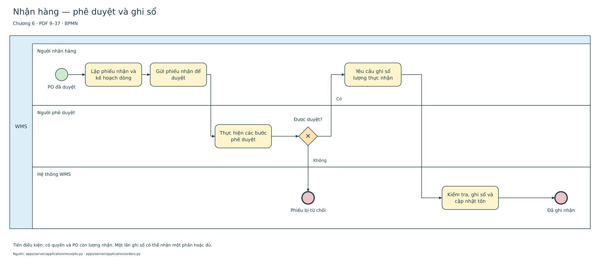

# Sơ đồ hệ thống WMS

[PDF — 141 trang](Hien_hanh/WMS_Hien_hanh.pdf) · [draw.io chỉnh sửa được](Hien_hanh/WMS_Hien_hanh.drawio) · [Mục lục SVG](Hien_hanh/index.md) · [Ký pháp theo giáo trình BA](NOTATION_GUIDE.md)

Bộ hiện hành gồm **136 sơ đồ và 5 trang mục lục**, đối chiếu mã nguồn, API và catalog PostgreSQL sau migration 001–026.

| Loại | Số sơ đồ | Nội dung |
|---|---:|---|
| Kiến trúc | 1 | Desktop, API, cơ sở dữ liệu, worker và kết nối |
| UML use case | 6 | 26 mục chức năng, actor, ranh giới hệ thống và association |
| UML lớp | 3 | Lớp thực tế, ngăn thuộc tính/phương thức, dependency và kế thừa |
| Trạng thái / hoạt động | 2 | Vòng đời chứng từ và xử lý/phục hồi lệnh |
| BPMN | 6 | Nhận, xuất, kiểm kê, chuyển kho, nhập tệp, tải lại/đóng ứng dụng |
| Vai trò và quyền | 10 | Quyền seed theo từng vai trò |
| ERD vật lý | 108 | 736 cột, 219 FK; Crow’s Foot và lực lượng quan hệ |

Các chương 6 và 8 cung cấp ký pháp chính: pool/lane, event, task, gateway; actor và use case; ngăn lớp; khóa và lực lượng quan hệ. [Bảng đối chiếu giáo trình](NOTATION_GUIDE.md) ghi trang PDF và cách áp dụng. Luồng mô tả hành vi phần mềm đã triển khai; các điều kiện quyền/lỗi chi tiết nằm trong service được dẫn nguồn.

Mỗi ERD trình bày đầy đủ cột bảng chính và FK đi ra; bảng liên quan chỉ hiện cột được tham chiếu. `PK` là khóa chính, `FK` là khóa ngoại, `?` là nullable. CHECK, UNIQUE và index đầy đủ tại [catalog](../02_CSDL/current/schema.json).

Các thư mục ngoài `Hien_hanh` lưu **91 trang thiết kế cơ sở**. Chúng giữ mô hình khái niệm và các đề xuất As-Is/To-Be ban đầu để truy vết, không thay cho bộ sơ đồ hiện hành.

[Cách đọc và phạm vi](RUNTIME_GUIDE.md) · [Nguồn từng sơ đồ](Hien_hanh/diagram_sources.json) · [Tái tạo tài liệu](../01_Tai_lieu/DOCUMENTATION.md).
