<p align="center"></p>

# WMS — Hệ thống quản lý kho

**Quản lý hàng hóa, chứng từ và vận hành kho trên ứng dụng desktop kết nối máy chủ qua mạng LAN.**

<table align="center">
  <tr>
    <td align="center" width="115"><a href="https://www.python.org/"><br><strong>Python · Tkinter</strong></a><br><sub>Ngôn ngữ · Desktop</sub></td>
    <td align="center" width="115"><a href="https://fastapi.tiangolo.com/"><br><strong>FastAPI</strong></a><br><sub>HTTP API</sub></td>
    <td align="center" width="115"><a href="https://www.mysql.com/"><br><strong>MySQL</strong></a><br><sub>Dữ liệu máy chủ</sub></td>
    <td align="center" width="115"><a href="https://www.postgresql.org/"><br><strong>PostgreSQL</strong></a><br><sub>Dữ liệu máy chủ</sub></td>
    <td align="center" width="115"><a href="https://www.sqlite.org/"><br><strong>SQLite</strong></a><br><sub>Nháp cục bộ</sub></td>
    <td align="center" width="115"><a href="https://www.sqlalchemy.org/"><br><strong>SQLAlchemy</strong></a><br><sub>Truy cập dữ liệu</sub></td>
    <td align="center" width="115"><a href="https://nginx.org/"><br><strong>Nginx</strong></a><br><sub>HTTPS · Reverse proxy</sub></td>
    <td align="center" width="115"><a href="https://docs.pytest.org/"><br><strong>pytest</strong></a><br><sub>Kiểm thử</sub></td>
  </tr>
</table>

WMS được viết bằng **Python**, dùng **Tkinter/ttk** cho giao diện, **FastAPI** cho API và **MySQL 8.0 hoặc PostgreSQL** làm cơ sở dữ liệu trung tâm. Hệ thống theo dõi quá trình từ đơn mua, nhận hàng, lưu kho, soạn/đóng kiện đến xuất kho, trả hàng, kiểm kê và đối soát; đồng thời quản lý người dùng, phê duyệt, truy vết và phục hồi các lệnh bị gián đoạn.

<a id="tai-ung-dung"></a>

## Hỗ trợ MySQL

Mã nguồn hỗ trợ **MySQL 8.0** qua SQLAlchemy và PyMySQL. WMS dùng database
`wms_mysql`; KWS dùng `kws_mysql`, tài khoản và API riêng. Các migration PostgreSQL
được giữ nguyên để phục hồi. Quy trình chuyển dữ liệu kiểm tra số bản ghi, SHA-256,
khóa ngoại và đối soát nghiệp vụ trước khi đổi kết nối ứng dụng.

Xem [triển khai MySQL](deploy/lan/mysql/README.md) và
[công cụ chuyển dữ liệu](mysql_migrations/README.md).
Bản triển khai ngày 16/10/2026 đã chuyển mã nguồn và dữ liệu sang MySQL;
xem [kết quả đối chiếu và kiểm thử](07_Kiem_tra/mysql/STATUS.md).

## Tải ứng dụng

<table align="center">
  <tr>
    <td align="center" width="260"><strong>Windows</strong><br><br><a href="https://github.com/TEAM-DEV-FIVE/WMS_BA_2_0/releases/download/v0.1.0-ui.20261018/WMS-Setup-0.1.0-7398faad9810-x64.exe"></a><br><br><a href="https://github.com/TEAM-DEV-FIVE/WMS_BA_2_0/releases/download/v0.1.0-ui.20261018/WMS-Setup-0.1.0-7398faad9810-x64.exe"><strong>Tải Windows (.exe)</strong></a><br><sub>Desktop x64 · bản thử nghiệm</sub></td>
    <td align="center" width="260"><strong>macOS</strong><br><br><a href="https://github.com/TEAM-DEV-FIVE/WMS_BA_2_0/releases/download/v0.1.0-ui.20261018/WMS-macos-arm64-TEST-ONLY.zip"></a><br><br><a href="https://github.com/TEAM-DEV-FIVE/WMS_BA_2_0/releases/download/v0.1.0-ui.20261018/WMS-macos-arm64-TEST-ONLY.zip"><strong>Tải macOS (.zip)</strong></a><br><sub>Desktop ARM64 · bản thử nghiệm</sub></td>
    <td align="center" width="260"><strong>Linux Server</strong><br><br><a href="https://github.com/TEAM-DEV-FIVE/WMS_BA_2_0/releases/download/v0.1.0-ui.20261018/WMS-Server-0.1.0-7398faad9810-linux-x64.tar.gz"></a><br><br><a href="https://github.com/TEAM-DEV-FIVE/WMS_BA_2_0/releases/download/v0.1.0-ui.20261018/WMS-Server-0.1.0-7398faad9810-linux-x64.tar.gz"><strong>Tải Linux Server (.tar.gz)</strong></a><br><sub>Máy chủ Linux x64</sub></td>
  </tr>
</table>

**[Xem tất cả bản phát hành](https://github.com/TEAM-DEV-FIVE/WMS_BA_2_0/releases)** · **[Tải mã nguồn main (.zip)](https://github.com/TEAM-DEV-FIVE/WMS_BA_2_0/archive/refs/heads/main.zip)** · [Hướng dẫn cài đặt](01_Tai_lieu/OPERATIONS_RUNBOOK.md) · [Hướng dẫn sử dụng](01_Tai_lieu/USER_GUIDE.md)

**Bản giao diện cập nhật ngày 18/10/2026**, đóng gói từ mã nguồn `7398faa`, gồm các thay đổi giao diện hiện hành và hỗ trợ máy chủ MySQL/PostgreSQL. Windows đã kiểm tra cài đặt trên Server 2022 x64; macOS trên 15 ARM64; gói Linux Server đã kiểm tra cài offline. [Kết quả đóng gói và SHA-256](07_Kiem_tra/release/UI_20261018.md).

Đây là **bản thử nghiệm**: Windows dùng chứng thư TEST ONLY, macOS ký ad-hoc và chưa notarize. Chưa có chứng thư phát hành công khai hoặc kết quả nghiệm thu Windows 10/11 trên máy người dùng.

**Cập nhật từ bản cũ:** đóng WMS bình thường, tải và cài gói mới ở trên, rồi mở shortcut **WMS Desktop** mới trên Desktop hoặc Start Menu. Shortcut ghim ở taskbar có thể vẫn trỏ đến thư mục phiên bản cũ; nếu còn giao diện cũ, bỏ ghim rồi ghim lại từ shortcut mới. Giữ nguyên thư mục dữ liệu cá nhân và cấu hình API. Nút **Tải lại** chỉ khởi động lại bản đang cài, không tải bản cập nhật từ Internet.

<a id="muc-luc"></a>

## Nội dung README

[Tổng quan](#tong-quan) · [Công nghệ](#cong-nghe) · [Kiến trúc và dữ liệu](#kien-truc) · [Chức năng kèm ảnh](#chuc-nang) · [Vận hành và cấu trúc mã](#van-hanh) · [Chạy từ mã nguồn](#chay-tu-ma-nguon) · [Kiểm chứng](#kiem-chung)

<a id="tong-quan"></a>

## Phạm vi hệ thống

Một chứng từ trong WMS không chỉ là danh sách sản phẩm: hệ thống theo dõi người lập, kho, nguồn hàng, định danh lô/serial, phiên bản và các bước phê duyệt trước khi ghi nhận thay đổi tồn. Nhân viên thao tác trên desktop; máy chủ kiểm tra quyền và điều kiện nghiệp vụ rồi lưu kết quả vào cơ sở dữ liệu chung.

| Nhóm người sử dụng | Công việc được hệ thống hỗ trợ |
|---|---|
| Mua hàng và bán hàng | Lập PO/SO, theo dõi lượng thực hiện và tình trạng chứng từ |
| Nhân viên kho | Nhận hàng, kiểm định, cất/di chuyển, soạn, đóng kiện, xuất và trả hàng |
| Quản lý kho | Phân công, phê duyệt trong phạm vi được cấp, chuyển kho, kiểm kê và xử lý chênh lệch |
| Kiểm soát và kiểm toán | Đối soát kỳ, tra sổ phát sinh, báo cáo và dấu vết thao tác theo quyền |
| Quản trị | Quản lý danh mục, tài khoản, phiên đăng nhập, vai trò, quyền và cấu hình triển khai |

Nhóm công việc trên giúp định hướng sử dụng; quyền thực tế được cấp riêng theo vai trò, kho và thời hạn. Hệ thống có hàng doanh nghiệp và hàng ký gửi; các nghiệp vụ được phép trên từng loại sở hữu do máy chủ kiểm tra.

### Các luồng nghiệp vụ chính

| Luồng | Các bước trong phần mềm |
|---|---|
| Nhập hàng | PO → phê duyệt → lập phiếu nhận → duyệt phiếu → ghi nhận từng phần hoặc đủ → kiểm định/cất hàng theo nghiệp vụ |
| Xuất hàng | SO → lập và duyệt phiếu xuất → giữ hàng khả dụng → soạn và đóng kiện → ghi sổ xuất |
| Chuyển kho | Lập và duyệt phiếu → xuất vào transit → nhận tại kho đích → xử lý chênh lệch nếu có |
| Kiểm kê | Chọn/khóa phạm vi → snapshot tồn → ghi đếm → nộp kết quả → xét duyệt → điều chỉnh được phép |
| Nhập dữ liệu | Chọn mẫu CSV/XLSX → kiểm tra tệp → tải lên → dry run → xem lỗi → xác nhận commit → tiếp tục chứng từ nếu cần |
| Mất phản hồi | Giữ nhật ký lệnh → tra ACK của yêu cầu cũ → nhận kết quả hoặc gửi lại đúng key/nội dung theo xác nhận |

Các luồng mô tả chức năng đã có trong mã nguồn. Điều kiện quyền, trạng thái, loại hàng và nhánh lỗi được trình bày trong [hướng dẫn người dùng](01_Tai_lieu/USER_GUIDE.md) và [tài liệu nghiệp vụ](01_Tai_lieu/HIEN_TRANG_BAO_CAO.md). Phạm vi hiện tại tập trung vào quản lý kho; giá tham chiếu phục vụ quản trị, chưa phải hệ thống kế toán giá vốn/công nợ.

<a id="cong-nghe"></a>

## Công nghệ và vai trò trong hệ thống

| Lớp / công việc | Công nghệ sử dụng | Vai trò cụ thể trong WMS |
|---|---|---|
| Ngôn ngữ | Python 3.12+ | Desktop, API, dịch vụ nghiệp vụ, worker và công cụ triển khai |
| Giao diện | Tkinter / ttk, Pillow | Cửa sổ desktop, form/bảng/tab, xử lý ảnh sản phẩm và ảnh đại diện |
| Giao tiếp | HTTPX | Client gọi API với timeout và xử lý phản hồi ngoài luồng giao diện |
| Máy chủ HTTP | FastAPI, Uvicorn | Khai báo route, xử lý yêu cầu và phục vụ API |
| Hợp đồng dữ liệu | Pydantic, pydantic-settings | Kiểm tra DTO, kiểu dữ liệu và cấu hình môi trường |
| Truy cập database | SQLAlchemy 2.0, PyMySQL, psycopg 3 | Kết nối, truy vấn có tham số, transaction và khóa dữ liệu |
| Dữ liệu trung tâm | MySQL 8.0 / PostgreSQL 15–16, SQL migrations | Chứng từ, sổ/số dư, định danh hàng, quyền, audit và job |
| Dữ liệu trên desktop | SQLite qua thư viện chuẩn Python | Nháp và nhật ký lệnh phục hồi tách theo máy chủ/tài khoản/thiết bị |
| Xác thực | argon2-cffi, cryptography, PyOTP, keyring | Băm mật khẩu, bảo vệ dữ liệu bí mật, MFA và lưu phiên trong vault hệ điều hành |
| Chứng từ và mã | ReportLab, pypdfium2, qrcode | Tạo PDF, xem trước PDF và mã QR; adapter hệ điều hành gửi máy in |
| Triển khai LAN | Nginx, systemd | HTTPS/reverse proxy và quản lý các tiến trình trên profile Linux |
| Đóng gói | PyInstaller; cấu hình Windows/macOS | Tạo gói desktop theo nền tảng; bộ Linux phục vụ triển khai server |
| Kiểm tra chất lượng | pytest, Ruff, GitHub Actions | Kiểm thử, kiểm tra mã và các workflow CI có trong repository |

Danh sách dựa trên [pyproject.toml](pyproject.toml), [dependency lock](requirements-app-lock.txt), [mã desktop](apps/desktop), [mã server](apps/server), [đóng gói](packaging) và [triển khai LAN](deploy/lan). Phiên bản dependency được cố định trong lockfile. Biểu tượng công nghệ lấy từ [Devicon v2.17.0](https://github.com/devicons/devicon/tree/v2.17.0) ([trang chính thức](https://devicon.dev/)).

<a id="kien-truc"></a>

## Kiến trúc và cách hệ thống xử lý dữ liệu

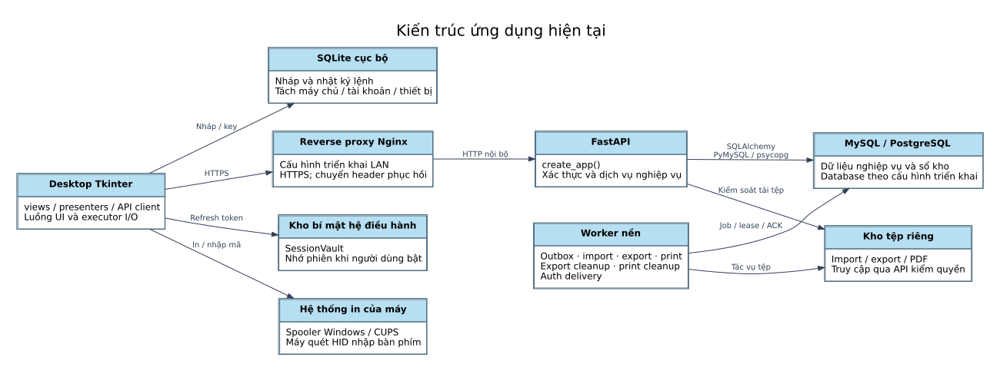

| Thành phần | Trách nhiệm và kết nối |
|---|---|
| Desktop | Hiển thị màn hình theo quyền, nhận thao tác và gọi HTTP API; widget cập nhật ở main thread, I/O chạy qua executor |
| Nginx | Nhận HTTPS và chuyển yêu cầu đến FastAPI trong cấu hình triển khai LAN |
| FastAPI và application services | Xác thực phiên, kiểm quyền/scope, trạng thái, phiên bản và quy tắc từng nghiệp vụ |
| PostgreSQL | Nguồn dữ liệu chính thức, lưu dữ liệu nghiệp vụ và kết quả chống trùng trong transaction |
| SQLite và OS vault | SQLite lưu nháp/nhật ký; vault hệ điều hành giữ thông tin phiên khi người dùng bật nhớ đăng nhập |
| Worker và kho tệp riêng | Xử lý job, tạo/tải tệp và dọn tệp dẫn xuất theo policy; API kiểm quyền khi tải |

### Quy trình xử lý thao tác ghi sổ

1. Desktop chuẩn bị nội dung, phiên bản chứng từ và khóa chống trùng (*idempotency key*); nhật ký phục hồi ghi lại yêu cầu trước khi gửi.
2. Server xác thực, kiểm tra quyền hiện tại và phạm vi tài nguyên. `CommandBus` tuần tự hóa cùng key và so khớp hash nội dung; key đã có kết quả hợp lệ được trả lại theo quyền hiện tại.
3. Handler nghiệp vụ kiểm tra trạng thái, nguồn hàng, lượng còn lại, kỳ kho và các điều kiện liên quan; khóa dữ liệu cần thiết trước khi cập nhật.
4. Dữ liệu nghiệp vụ và kết quả chống trùng được commit cùng đơn vị công việc; handler ghi sổ/số dư/audit/outbox tương ứng. Giao dịch không hợp lệ bị từ chối.
5. Desktop nhận kết quả xác nhận. Nếu mất phản hồi, trạng thái giữ là chưa rõ; tra ACK bằng yêu cầu gốc với `X-WMS-Recovery: lookup-v1` trước khi quyết định gửi lại.

Nguồn: [CommandBus](apps/server/application/commands.py), [Unit of Work PostgreSQL](apps/server/infrastructure/database.py), [recovery API](apps/server/api/recovery.py), [journal desktop](apps/desktop/local_store/recovery.py).

### Tổ chức dữ liệu kho

| Nhóm dữ liệu | Các đối tượng chính | Ý nghĩa |
|---|---|---|
| Danh mục | Sản phẩm, UOM/quy đổi, barcode, nhóm hàng, kho/vị trí, đối tác | Dữ liệu tham chiếu dùng khi lập và thực hiện chứng từ |
| Định danh hàng | Sản phẩm + lô hoặc serial + chủ sở hữu/hợp đồng | Phân biệt hàng thường, hàng theo lô/hạn dùng, serial và hàng ký gửi |
| Chứng từ | Phiếu, dòng phiếu, liên kết nguồn, phân công và snapshot phê duyệt | Theo dõi phiên bản, nguồn phát sinh và lượng đã/chưa thực hiện |
| Tồn và vận hành | Stock move, balance, reservation, pick task, package, transit | Ghi phát sinh, số dư, lượng giữ, soạn/kiện và hàng đang chuyển |
| Kiểm soát | Phiên kiểm kê, quan sát đếm, quyết định, kỳ kho, phiếu đảo | Đối soát và điều chỉnh có căn cứ; đảo bằng giao dịch bù |
| Hệ thống | User/role/permission, phiên, audit, idempotency, outbox và job | Quản lý truy cập, truy vết và xử lý tác vụ nền |

Số lượng trao đổi qua API bằng chuỗi decimal. Phân loại sở hữu được giữ trong định danh hàng. Sổ tồn đã ghi được bảo vệ theo các bất biến; sửa sai đi qua nghiệp vụ điều chỉnh/đảo được phép. Chi tiết tại [bất biến dữ liệu](01_Tai_lieu/INVARIANTS.md), [schema](02_CSDL/README.md) và [API runtime](05_API/README.md).

### Phân quyền và bảo vệ thao tác

Quyền được kiểm tra trên máy chủ, kể cả khi tra lại kết quả cũ; việc ẩn nút ở giao diện chỉ hỗ trợ sử dụng. Hệ thống kiểm soát phạm vi kho, thời hạn cấp quyền, tách nhiệm vụ lập/duyệt, quyền xem giá và phiên bản chứng từ. MFA và các thao tác quản trị phiên bổ sung kiểm soát tài khoản; email/SMS/Google hoạt động khi máy chủ đã có cấu hình tương ứng.

Desktop gọi API và không mang thông tin kết nối PostgreSQL. Nháp/journal không lưu mật khẩu hoặc token; nhớ phiên sử dụng kho bí mật hệ điều hành. Nút **Tải lại** chạy quy trình đóng có xác nhận và chờ tài nguyên nền, rồi khởi động lại bản ứng dụng đang cài. Nút này không tự tải bộ cài mới từ Internet.

## Quy mô mã nguồn hiện tại

| Thành phần | Số liệu đối chiếu |
|---|---|
| Cơ sở dữ liệu PostgreSQL | 108 bảng, 736 cột, 219 khóa ngoại trong schema `wms` |
| Migration | PostgreSQL 001–026; SQLite 001–003 |
| API | 199 đường dẫn, 249 thao tác HTTP trong OpenAPI runtime |
| Quyền được seed | 10 vai trò, 58 quyền |
| Giao diện | 26 mục trên menu chức năng; thêm màn đăng nhập và các hộp thoại/tabs bên trong |
| Phiên bản ứng dụng | `0.1.0`; bản cài phát hành được định danh riêng theo commit |

Số liệu schema được đọc từ PostgreSQL tạm sau khi chạy toàn bộ migration. [Catalog hiện hành](02_CSDL/current/schema.json) lưu cột, ràng buộc và index; [DBML hợp nhất](02_CSDL/current/wms.dbml) và [từ điển dữ liệu](02_CSDL/current/dictionary.csv) dùng cho báo cáo. Số liệu mô tả cấu trúc schema và hợp đồng API.

<a id="chuc-nang"></a>

## Chức năng và ảnh giao diện

Dưới đây là đủ 26 mục chức năng trong menu hiện tại và màn hình đăng nhập. Ảnh chụp trực tiếp từ ứng dụng ngày 13/10/2026 trên dữ liệu thực hành; chức năng/màn hình được mở theo quyền tài khoản. [Nguồn ảnh và SHA-256](assets/readme/screenshots.json) · [Thuyết minh báo cáo](01_Tai_lieu/HIEN_TRANG_BAO_CAO.md) · [PDF sơ đồ](03_So_do/Hien_hanh/WMS_Hien_hanh.pdf) · [draw.io](03_So_do/Hien_hanh/WMS_Hien_hanh.drawio).

## Đăng nhập và giao diện chung

Đăng nhập tài khoản, MFA, nhớ phiên qua kho bí mật hệ điều hành, đổi mật khẩu và khôi phục tài khoản. Mã nguồn có luồng email/SMS và Google; khả năng sử dụng phụ thuộc cấu hình máy chủ và dịch vụ ngoài. Hồ sơ cho phép đổi tên hiển thị và ảnh đại diện. Thanh trên có tìm chức năng, hỗ trợ, menu tài khoản, chế độ sáng/tối và **Tải lại**. Khi đóng hoặc tải lại, ứng dụng hỏi xác nhận và chờ tác vụ nền kết thúc.

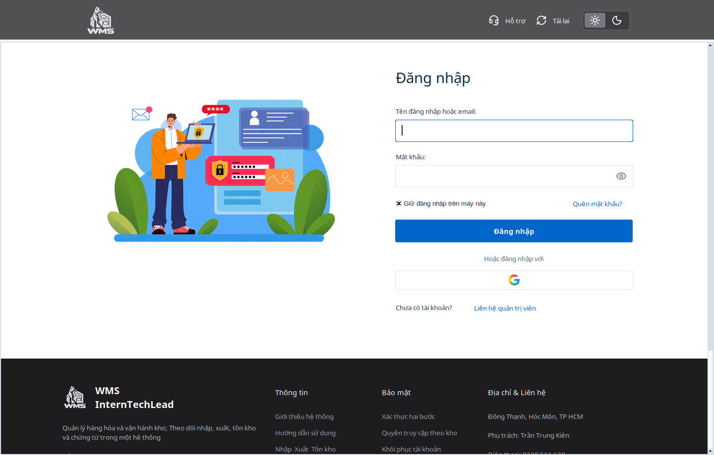

Nguồn: [giao diện tài khoản](apps/desktop/views/session.py), [xác thực mở rộng](apps/server/api/modern_identity.py), [vòng đời desktop](apps/desktop/lifecycle.py).

## Không gian làm việc

### Kho làm việc

Chọn kho làm việc, xem quyền, quản lý phiên, đổi mật khẩu, thiết lập MFA và đăng xuất. Menu tài khoản hiển thị tên/ảnh đại diện, mở chỉnh sửa hồ sơ và đổi ảnh.

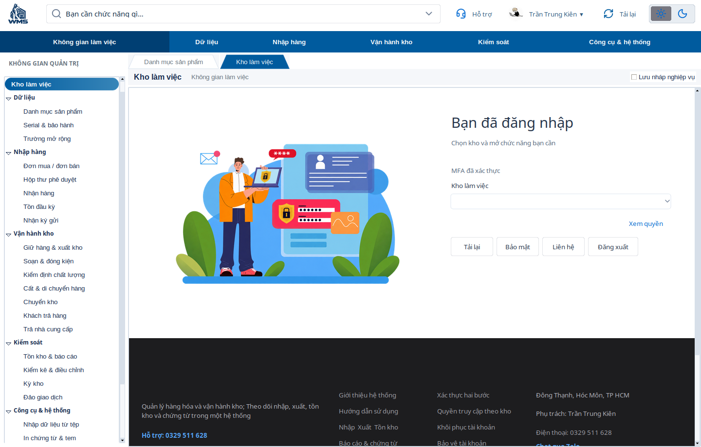

[Mã nguồn chức năng](apps/desktop/views/session.py)

## Dữ liệu

### Danh mục sản phẩm

Quản lý sản phẩm, đơn vị tính, nhóm hàng, kho, vị trí và đối tác; tìm kiếm và phân trang. Các tab riêng quản lý quy đổi đơn vị, barcode, giá tham chiếu, chủ hàng, hợp đồng ký gửi và tồn theo chủ sở hữu. Có hồ sơ ảnh và mô tả sản phẩm.

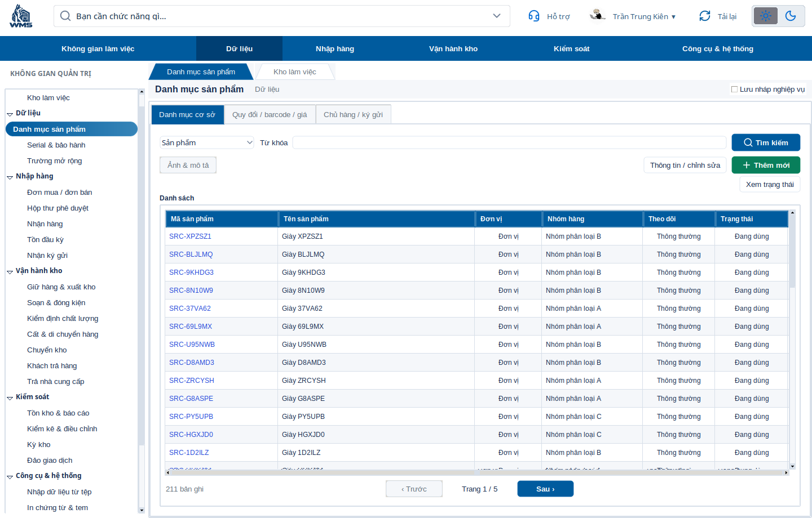

[Mã nguồn chức năng](apps/desktop/views/master_data.py)

### Serial & bảo hành

Duyệt hoặc tra chính xác serial, xem lịch sử truy vết và chứng cứ bảo hành theo quyền hiện tại. Thông tin nguồn, ngày nhập và mốc bảo hành được lấy từ dữ liệu đã lưu.

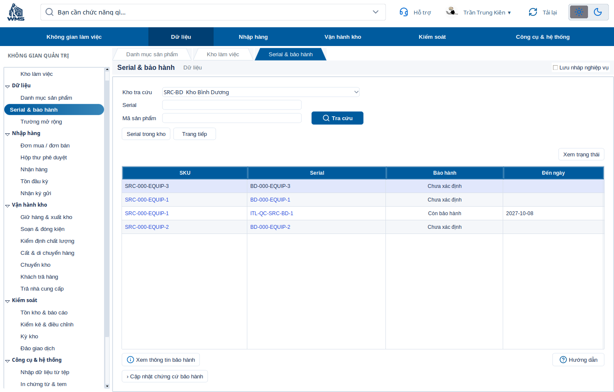

[Mã nguồn chức năng](apps/desktop/views/serial_lookup.py)

### Trường mở rộng

Định nghĩa bộ trường có kiểu, xuất bản phiên bản và nhập giá trị bổ sung cho đối tượng. Xem lịch sử giá trị; chuyển phiên bản khi lưu theo kiểm tra của máy chủ.

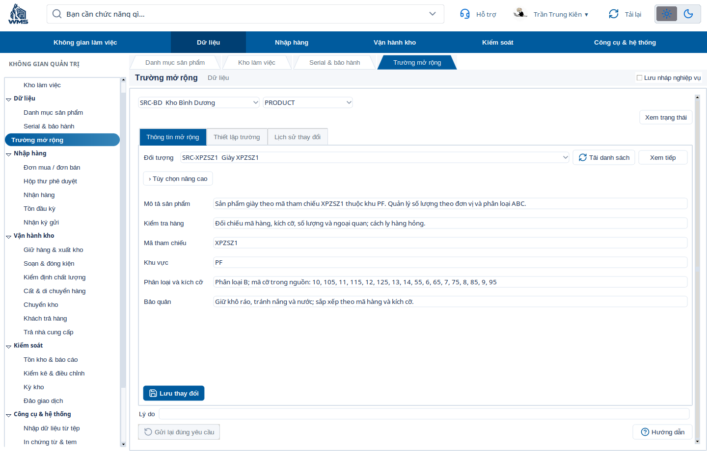

[Mã nguồn chức năng](apps/desktop/views/custom_fields.py)

## Nhập hàng

### Đơn mua / đơn bán

Lập và sửa đơn mua PO/đơn bán SO; thêm dòng hàng, giao người xử lý, gửi duyệt, sửa lại hoặc hủy theo trạng thái. Danh sách, chi tiết và lịch sử được tách để theo dõi từng chứng từ.

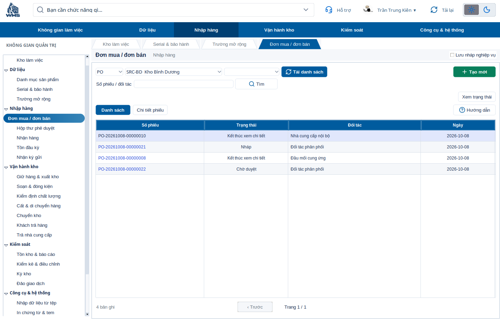

[Mã nguồn chức năng](apps/desktop/views/orders.py)

### Hộp thư phê duyệt

Xem phiếu chờ phê duyệt theo loại và kho, đọc nội dung/snapshot, duyệt hoặc từ chối kèm lý do. Máy chủ kiểm tra quyền, phiên bản và phân tách nhiệm vụ; không cho tự duyệt trái quy định.

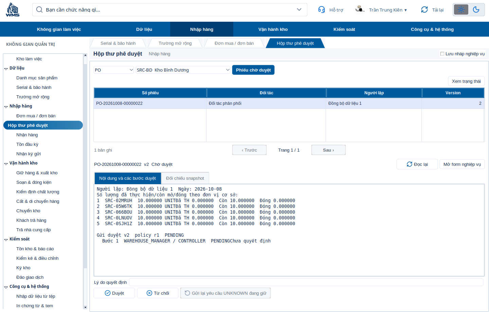

[Mã nguồn chức năng](apps/desktop/views/approvals.py)

### Nhận hàng

Lập phiếu nhận từ PO, chọn vị trí nhận và định danh hàng; duyệt rồi ghi sổ theo lượng thực nhận. Hỗ trợ nhận từng phần, tra kết quả ghi sổ và nhập mã bằng máy quét HID.

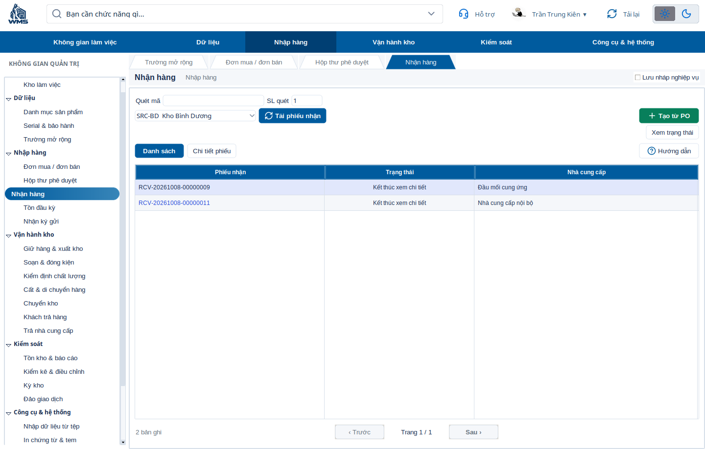

[Mã nguồn chức năng](apps/desktop/views/receipts.py)

### Tồn đầu kỳ

Lập tồn đầu kỳ theo kho, sản phẩm, vị trí, lô/serial và chủ sở hữu. Có biên bản nguồn, gửi duyệt và ghi sổ; điều kiện khởi tạo được kiểm tra ở máy chủ.

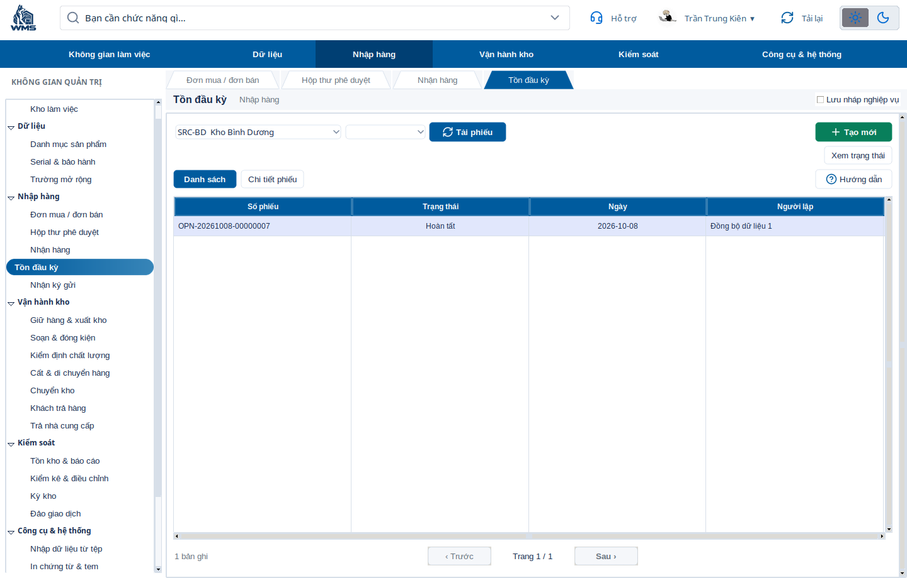

[Mã nguồn chức năng](apps/desktop/views/openings.py)

### Nhận ký gửi

Tiếp nhận hàng ký gửi gắn với chủ hàng và hợp đồng; lập dòng, gửi duyệt và ghi sổ nhận. Hàng ký gửi giữ định danh sở hữu riêng trong tồn kho.

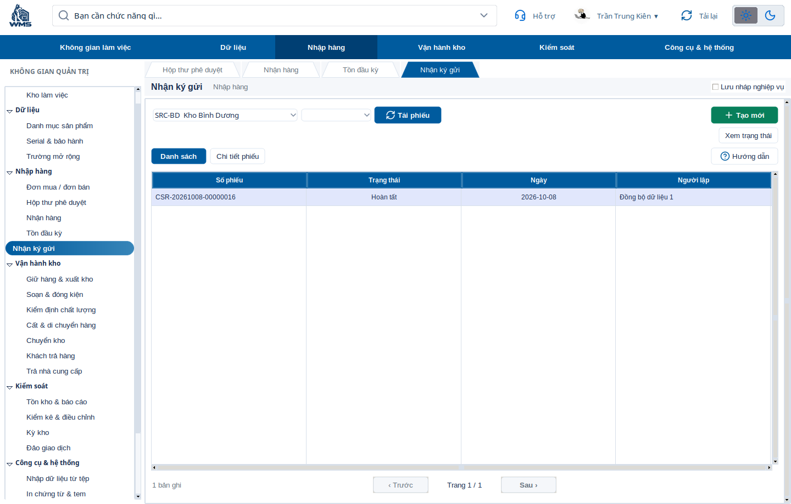

[Mã nguồn chức năng](apps/server/application/consignments.py)

## Vận hành kho

### Giữ hàng & xuất kho

Lập phiếu xuất từ SO, đề xuất nguồn giữ hàng theo khả dụng/FEFO, giữ hoặc giải phóng lượng giữ. Xuất một phần hoặc toàn bộ theo chứng từ được duyệt, có kiểm tra phiên bản và truy vết kết quả.

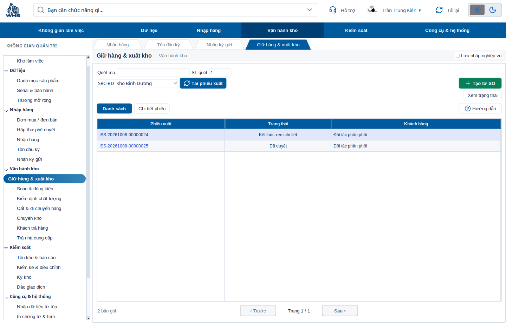

[Mã nguồn chức năng](apps/desktop/views/issues.py)

### Soạn & đóng kiện

Phân công và xử lý tác vụ soạn hàng, quét mã, ghi lượng thực soạn, đóng kiện và quản lý nội dung kiện. Kiểm tra nguồn giữ hàng, quyền người thao tác và trạng thái phiếu xuất.

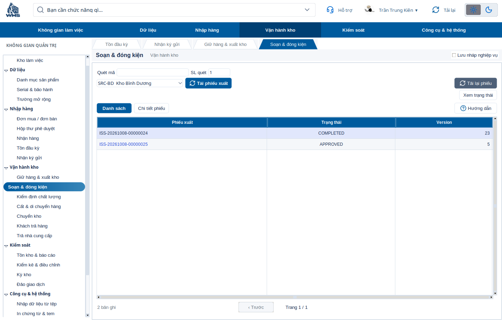

[Mã nguồn chức năng](apps/desktop/views/fulfillment.py)

### Kiểm định chất lượng

Xem hàng cần kiểm định, ghi quyết định chất lượng và lượng được chấp nhận hoặc cách ly. Quyết định chất lượng làm căn cứ cho thao tác cất và di chuyển tiếp theo.

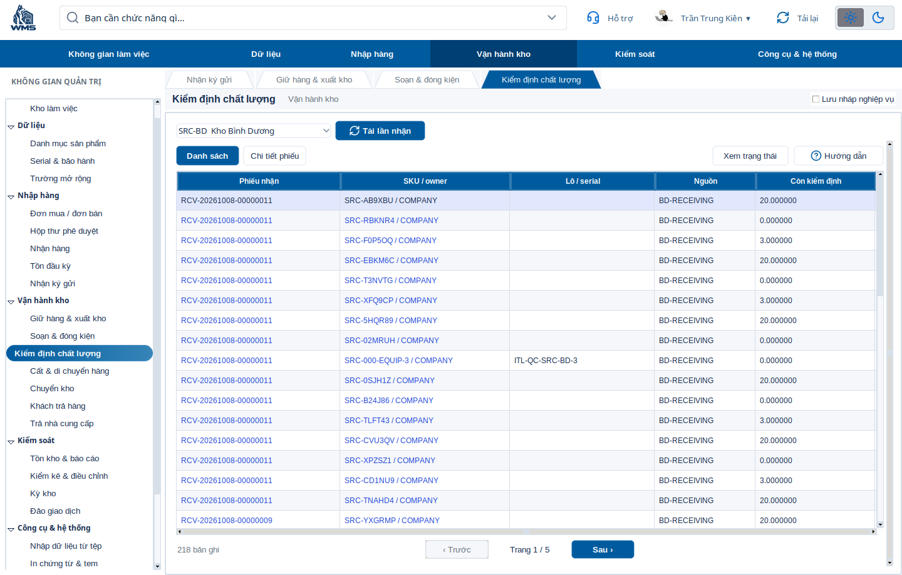

[Mã nguồn chức năng](apps/desktop/views/quality.py)

### Cất & di chuyển hàng

Chọn nguồn tồn và vị trí đích để cất hoặc di chuyển hàng trong kho. Liên kết quyết định kiểm định khi cần; có lập nháp, phê duyệt và ghi sổ.

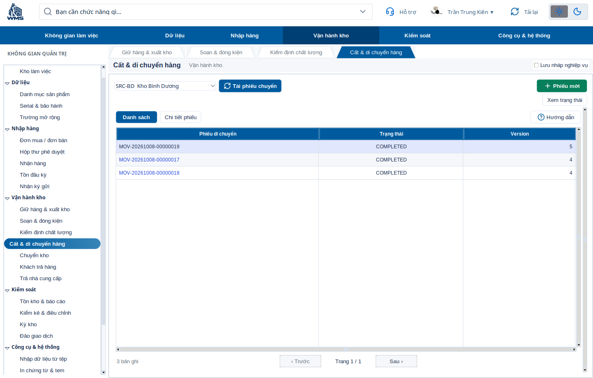

[Mã nguồn chức năng](apps/desktop/views/moves.py)

### Chuyển kho

Lập chuyển kho, theo dõi lượng đã gửi, đã nhận và còn đang vận chuyển. Có lịch sử giao nhận, xử lý thiếu/hỏng và chứng cứ chênh lệch; kiểm tra phạm vi quyền tại các kho liên quan.

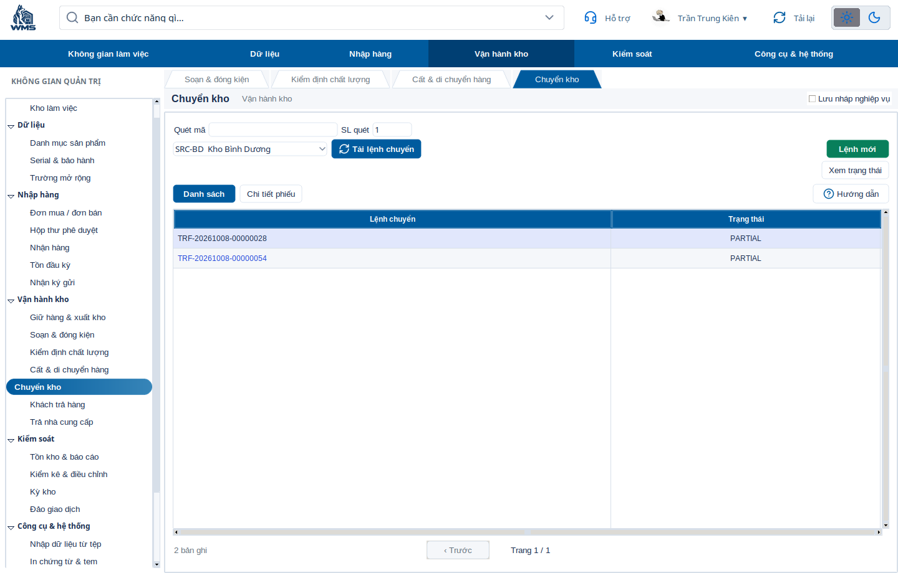

[Mã nguồn chức năng](apps/desktop/views/transfers.py)

### Khách trả hàng

Lập phiếu khách trả hàng tham chiếu chứng từ xuất; kiểm tra hàng và lượng có thể trả, phê duyệt rồi ghi nhận về vị trí được phép.

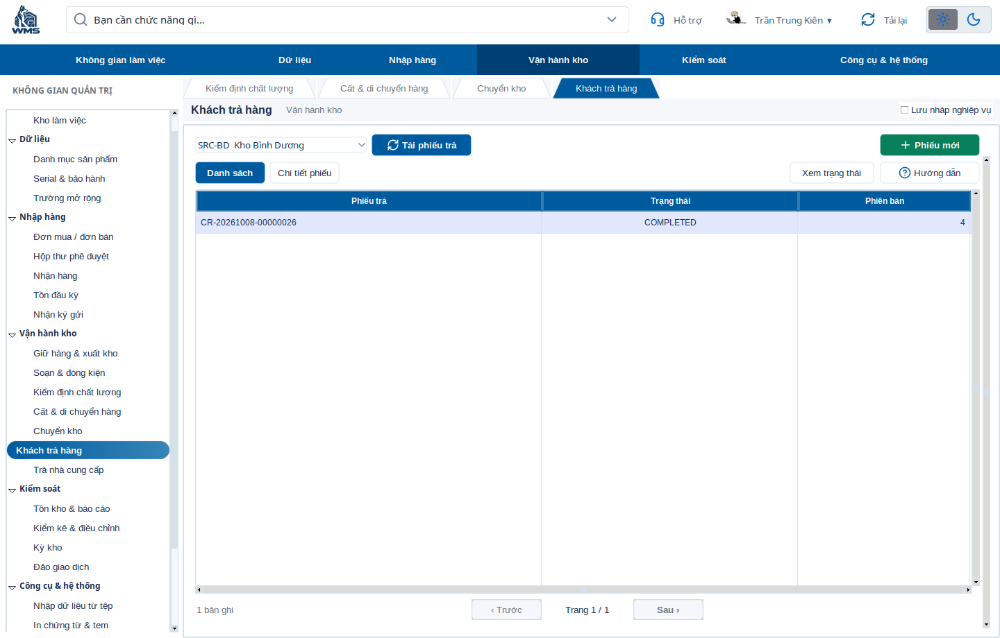

[Mã nguồn chức năng](apps/desktop/views/returns.py)

### Trả nhà cung cấp

Lập phiếu trả nhà cung cấp có tham chiếu nguồn nhận; chọn nguồn tồn, kiểm tra số lượng, gửi duyệt và ghi sổ trả.

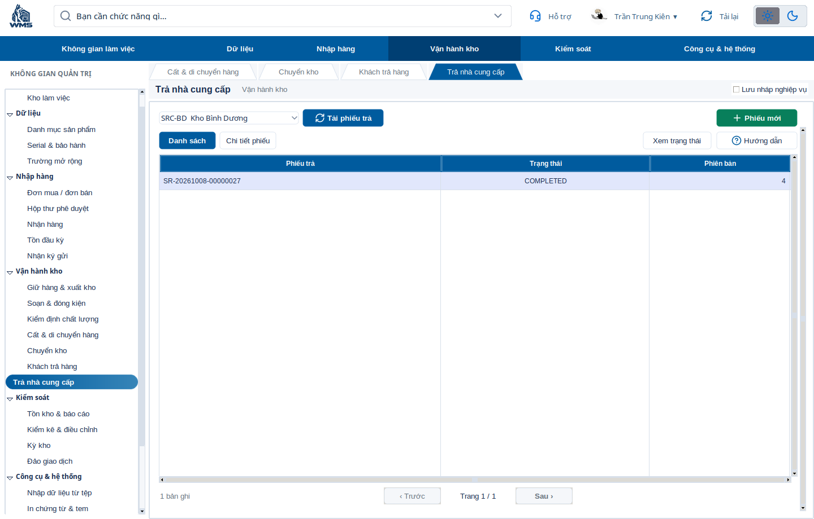

[Mã nguồn chức năng](apps/server/application/returns.py)

## Kiểm soát

### Tồn kho & báo cáo

Tra cứu R01 tồn theo vị trí; R02 nhập/xuất qua ranh giới; R03 thẻ kho; R04 giữ hàng/nhu cầu mở; R05 chuyển kho/transit; R06 hạn dùng/tồn lâu; R07 kiểm kê; R08 hoạt động/giá tham chiếu. Lọc, phân trang, xuất CSV/XLSX, theo dõi job và lịch sử export. Giá tham chiếu cần quyền giá, không phải giá vốn kế toán.

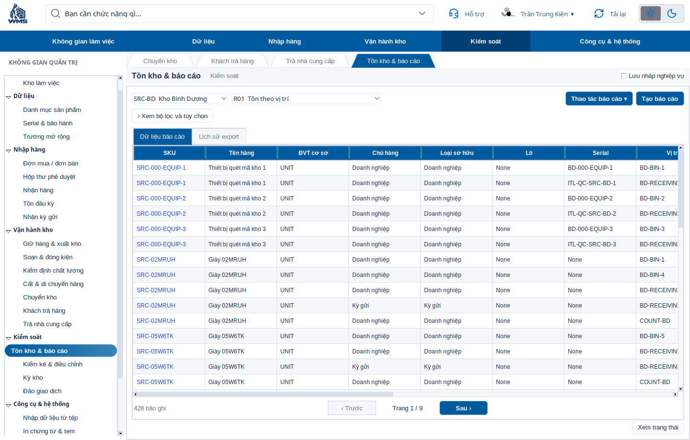

[Mã nguồn chức năng](apps/desktop/views/reports.py)

### Kiểm kê & điều chỉnh

Tạo phiên kiểm kê, chọn và đóng băng phạm vi, chụp snapshot tồn, ghi các lần đếm hoặc xác nhận vị trí trống. Nộp, xét duyệt chênh lệch và ghi điều chỉnh theo quy trình.

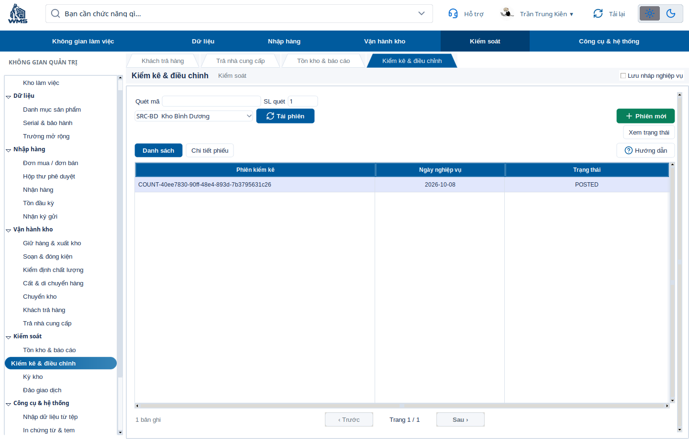

[Mã nguồn chức năng](apps/desktop/views/counting.py)

### Kỳ kho

Xem và mở kỳ kho, khóa kỳ/đối soát, xác nhận và thực hiện mở lại kỳ theo vai trò và MFA. Thông tin kỳ và quy định hiển thị khi cần; có tra ACK cho thao tác ghi.

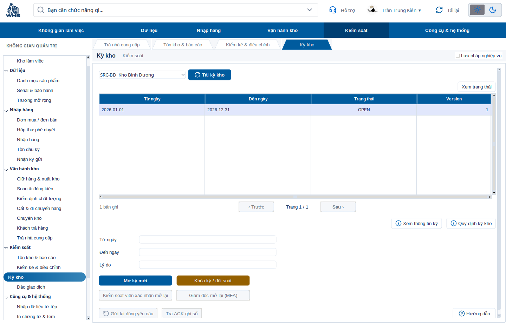

[Mã nguồn chức năng](apps/desktop/views/periods.py)

### Đảo giao dịch

Lập phiếu đảo có tham chiếu giao dịch gốc, lý do, phê duyệt và ghi bút toán bù. Không sửa trực tiếp giao dịch tồn đã ghi sổ.

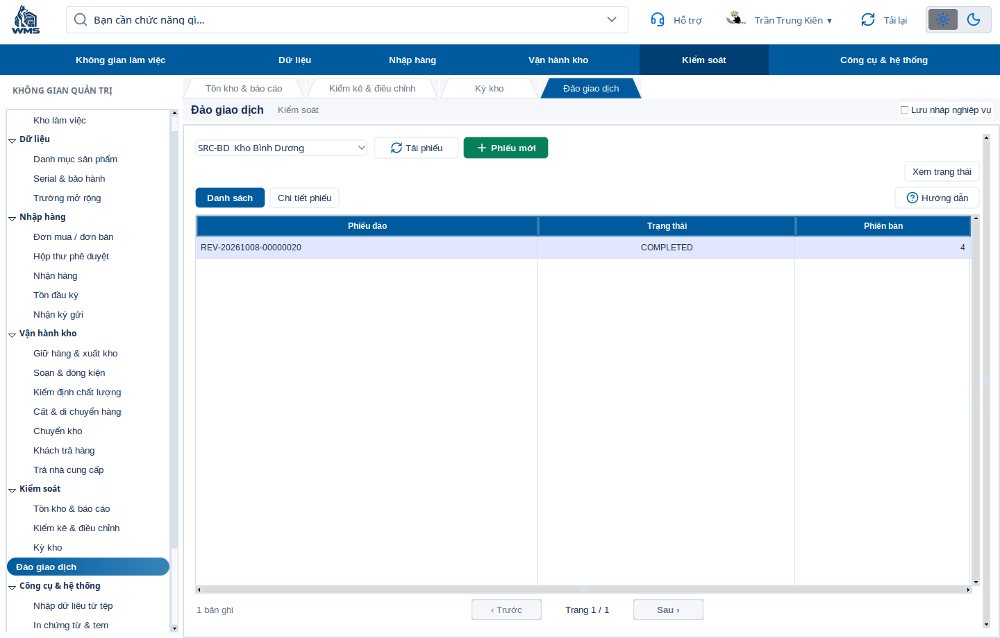

[Mã nguồn chức năng](apps/desktop/views/reversals.py)

## Công cụ & hệ thống

### Nhập dữ liệu từ tệp

Tải mẫu CSV/XLSX, chọn và upload tệp, tạo job/dry run, xem lỗi từng dòng, xác nhận commit và xem lịch sử nhập. Tồn đầu kỳ/đơn hàng nhập từ tệp tạo chứng từ để tiếp tục nghiệp vụ. Kiểm tra lại, hủy và khôi phục yêu cầu nằm trong menu Thao tác khác.

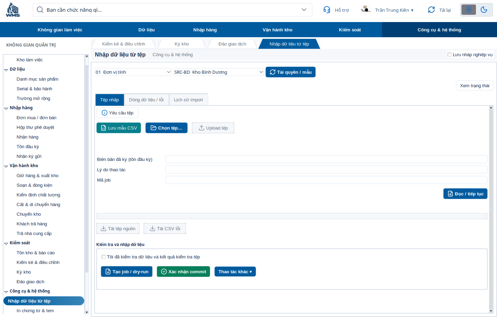

[Mã nguồn chức năng](apps/desktop/views/imports.py)

### In chứng từ & tem

Chọn chứng từ hoặc hàng, mẫu và khổ giấy; tạo PDF tiếng Việt, xem trước khi mở thao tác in, lưu PDF hoặc gửi máy in. Có phiếu nhận, xuất, chuyển, kiểm kê và tem sản phẩm/vị trí; theo dõi trạng thái, in lại và kiểm tra yêu cầu.

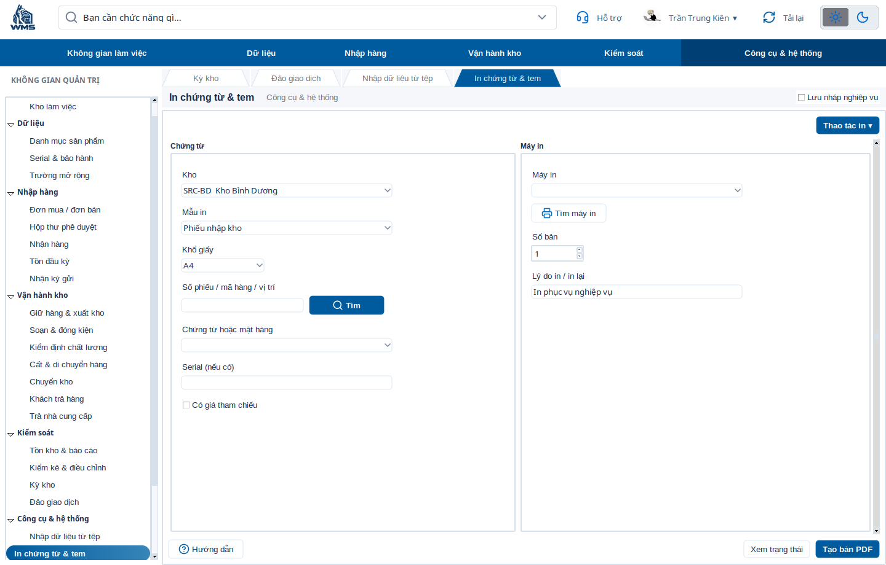

[Mã nguồn chức năng](apps/desktop/printing/view.py)

### Tài khoản & phân quyền

Quản lý tài khoản, trạng thái hoạt động, vai trò và quyền theo kho/thời hạn; xử lý yêu cầu cấp quyền, thu hồi phiên và các thao tác bảo mật theo quyền hiện tại.

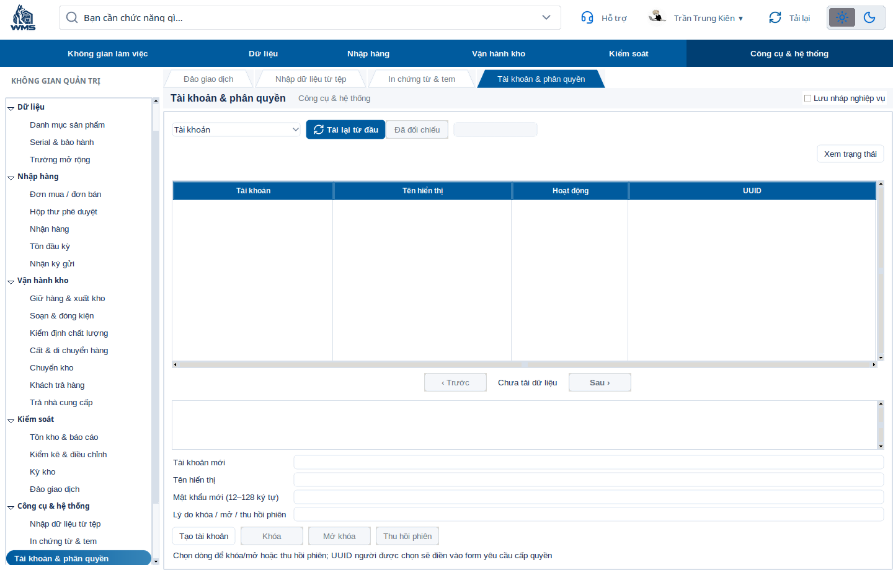

[Mã nguồn chức năng](apps/desktop/views/admin.py)

### Nháp & phục hồi lệnh

Xem nhật ký nháp và lệnh theo thiết bị/tài khoản/máy chủ; tra ACK, xem nội dung, sửa hoặc bỏ nháp chưa gửi. Gửi lại dùng đúng key và nội dung. Danh sách và chi tiết nằm ở hai tab riêng.

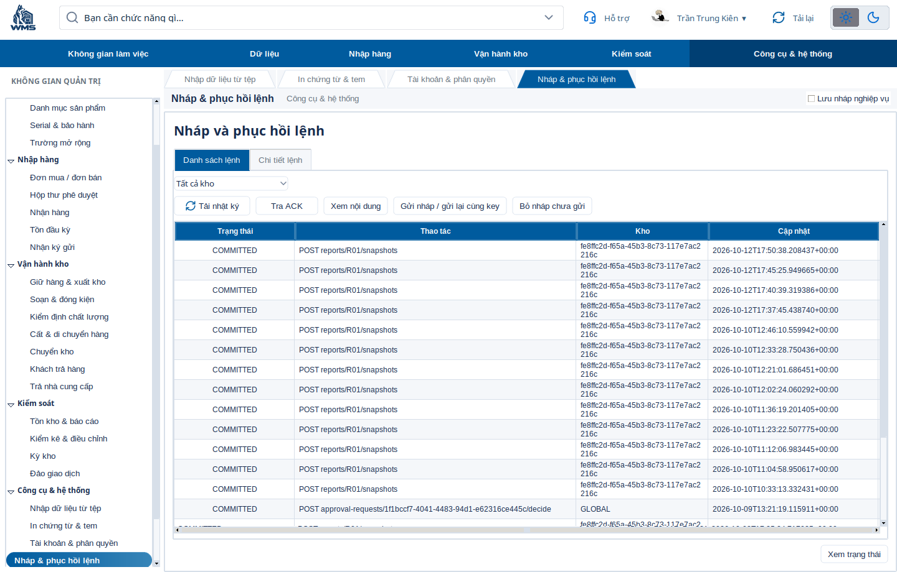

[Mã nguồn chức năng](apps/desktop/views/recovery.py)

### Phục hồi nhận hàng

Tra các lần ghi sổ nhận hàng bị gián đoạn, kiểm tra kết quả máy chủ và tiếp tục với đúng yêu cầu cũ. Không tự ghi nhận thành công khi chưa có xác nhận.

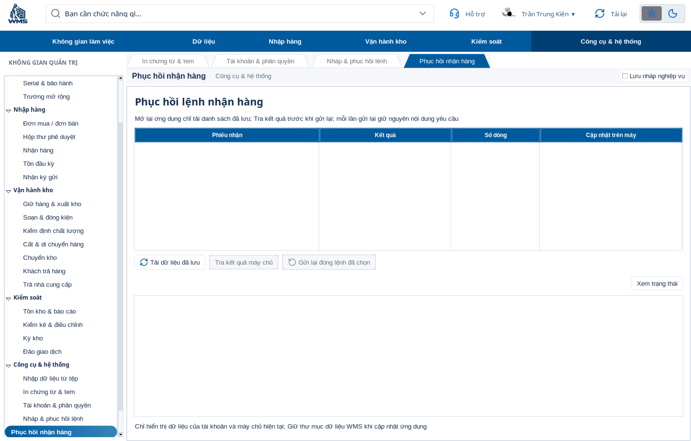

[Mã nguồn chức năng](apps/desktop/views/receipt_recovery.py)

### Kết nối máy chủ

Kiểm tra kết nối API và trạng thái sẵn sàng của máy chủ/cơ sở dữ liệu. Hiển thị địa chỉ API được cấu hình và kết quả kiểm tra.

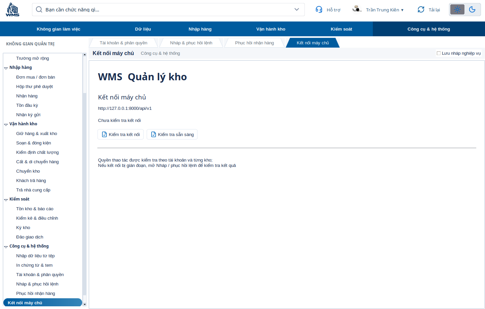

[Mã nguồn chức năng](apps/desktop/views/shell.py)

<a id="van-hanh"></a>

## Vận hành hệ thống và cấu trúc mã nguồn

### Bảy loại worker

| Worker | Nhiệm vụ |
|---|---|
| Outbox | Nhận sự kiện đã commit và điều phối consumer/tác vụ |
| Import | Thực hiện các bước job nhập tệp theo trạng thái và quyền |
| Export | Tạo kết quả xuất báo cáo CSV/XLSX |
| Print | Render tài liệu PDF phục vụ tải/xem/in |
| Export cleanup | Dọn tệp export dẫn xuất theo chính sách giữ tệp |
| Print cleanup | Dọn tệp PDF dẫn xuất theo chính sách giữ tệp |
| Auth delivery | Gửi thông báo/mã xác thực qua kênh được cấu hình |

Job có trạng thái, cơ chế nhận việc và kiểm soát xử lý lại trong mã server. Các worker chạy thành tiến trình riêng theo cấu hình triển khai. Gửi tới máy in là bước tương tác thiết bị, không thể suy ra giấy đã in thành công chỉ từ việc giao dịch DB đã commit.

### Cấu trúc repository

| Đường dẫn | Nội dung |
|---|---|
| [apps/desktop](apps/desktop) | Giao diện, presenter, API client, nhật ký SQLite, in/quét mã và tài nguyên ảnh |
| [apps/server](apps/server) | Route API, application services, hạ tầng PostgreSQL, worker và tác vụ tệp |
| [packages/contracts](packages/contracts) | DTO dùng chung giữa desktop và server |
| [migrations](migrations) | SQL nâng schema và seed theo revision có checksum |
| [tests](tests) | Các bộ kiểm thử ứng dụng, giao dịch, API và desktop |
| [deploy](deploy), [packaging](packaging) | Triển khai LAN, cấu hình dịch vụ và đóng gói nền tảng |
| [scripts](scripts) | Vận hành, kiểm tra artifact, trích schema/API, dựng tài liệu và chụp ảnh |
| [01_Tai_lieu](01_Tai_lieu) | Hồ sơ nghiệp vụ, kiến trúc, hướng dẫn người dùng và runbook |
| [02_CSDL](02_CSDL), [03_So_do](03_So_do), [05_API](05_API) | Catalog dữ liệu, ERD/lớp/luồng và OpenAPI |
| [assets/readme](assets/readme), [07_Kiem_tra](07_Kiem_tra) | Ảnh chức năng, manifest và bằng chứng kiểm tra |

### Triển khai và bảo trì

Cấu hình LAN có HTTPS, kiểm tra health/readiness, quyền DB runtime riêng, service/worker, kho tệp riêng và công cụ backup/PITR, nâng cấp, rollback. PostgreSQL và kho tệp cần được quản lý cùng quy trình sao lưu/khôi phục. Kết nối email/SMS/Google, vault và máy in phụ thuộc môi trường; chỉ bật khi đã cấu hình.

[Runbook máy chủ LAN](01_Tai_lieu/LAN_DEPLOYMENT.md) · [Cài đặt/vận hành](01_Tai_lieu/OPERATIONS_RUNBOOK.md) · [Cấu hình runtime mẫu](deploy/lan/runtime.env.example) · [Hướng dẫn người dùng](01_Tai_lieu/USER_GUIDE.md)

<a id="chay-tu-ma-nguon"></a>

## Chạy từ mã nguồn

Yêu cầu phát triển: Python 3.12, Tkinter và PostgreSQL 15/16. Cài dependency theo [requirements-app-lock.txt](requirements-app-lock.txt), cấu hình API/cơ sở dữ liệu theo [hướng dẫn triển khai](01_Tai_lieu/LAN_DEPLOYMENT.md). PostgreSQL cần có database và tài khoản được chuẩn bị trước; Tkinter/Tcl-Tk phải có trên máy chạy desktop.

| Cấu hình | Dùng ở đâu | Ý nghĩa |
|---|---|---|
| `WMS_DATABASE_URL` | Server / migration | DSN dùng driver `mysql+pymysql` hoặc `postgresql+psycopg`; desktop không cần biến này |
| `WMS_API_URL` | Desktop | URL API kết thúc bằng `/api/v1`; LAN dùng HTTPS, local development cho phép HTTP loopback |
| `WMS_CA_FILE` | Desktop | Đường dẫn CA nội bộ khi triển khai TLS với CA riêng |
| `WMS_MFA_ENCRYPTION_KEY` | Server | Khóa Fernet do quản trị tạo và giữ riêng, cần cho đăng ký/sử dụng MFA |
| `WMS_LOCAL_DATA_DIR` | Desktop | Thư mục nháp/journal trên đĩa cục bộ; giữ qua các lần nâng cấp |

Xem [.env.example](.env.example) để biết các biến. File này là mẫu; server không tự đọc `.env`, cần xuất biến môi trường hoặc cấu hình service. Sau khi cấu hình, chạy ở thư mục gốc repository:

```bash
python -m apps.server.infrastructure.migrations
python -m apps.server
# Terminal khác
python -m apps.desktop
```

Migration chỉ chạy khi người quản trị yêu cầu; API không tự nâng schema khi khởi động. Khởi tạo/cấp tài khoản theo [hướng dẫn IAM](01_Tai_lieu/IDENTITY.md); không có mật khẩu mặc định trong README. Client kết nối LAN sử dụng HTTPS với CA tin cậy. Các tác vụ import/export/in cần worker tương ứng được bật theo runbook.

<a id="kiem-chung"></a>

## Tài liệu và kiểm chứng

| Tài liệu | Nội dung |
|---|---|
| [Sơ đồ hệ thống](03_So_do/README.md) | Use case, BPMN, UML lớp, trạng thái, kiến trúc, quyền và ERD; PDF/SVG/draw.io |
| [Ký pháp theo giáo trình BA](03_So_do/NOTATION_GUIDE.md) | Đối chiếu chương/trang, quy ước và nguồn dữ liệu từng loại sơ đồ |
| [Hiện trạng hệ thống](01_Tai_lieu/HIEN_TRANG_BAO_CAO.md) | Chức năng, schema, API và phạm vi bằng chứng |
| [Kiểm tra tài liệu](07_Kiem_tra/current_report/README.md) | Kết quả kiểm tra sơ đồ, schema, ảnh và liên kết |
| [Bàn giao 0.1.0](07_Kiem_tra/release/FINAL_HANDOVER.md) | Bằng chứng kiểm thử gắn với commit `97d4c51` và các cổng nghiệm thu |
| [Bảo trì tài liệu](01_Tai_lieu/DOCUMENTATION.md) | Lệnh xuất schema/API, dựng sơ đồ, chụp ảnh và kiểm định artifact |

[Tải ứng dụng](#tai-ung-dung) · [Mục lục](#muc-luc)
